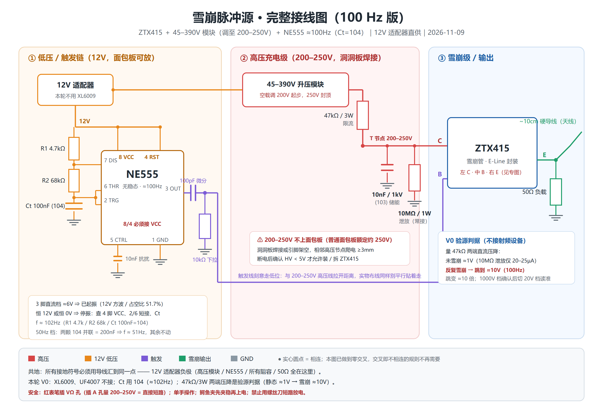

# 从零做一个局放信号模拟源（V0 · 新人教程）

> **适用人群**：纯软件背景、第一次拿电烙铁、单人开发、没有示波器也能开工。
> **这一版要做到**：一块自己焊的板子，每隔约 10 ms 发出一个 ns 级 UHF 脉冲，并且**不用任何射频仪器就能证明它真的在发**。
> **硬件版本**：ZTX415 + 45–390V 模块（**200V 起步、250V 封顶**）+ 12V 适配器 + NE555 ≈100 Hz。
> **定稿日期**：2026-11-09。所有数值都是这一天实算并纠错后的版本，早期聊天里的 270V / 1kHz / 2N2377 一律作废。

配套文件（建议按这个顺序读）：

| 顺序 | 文件 | 用途 |
|---|---|---|
| ① | **本文** | 从零建立概念、算清参数、按步动手 |
| ② | [`figures/雪崩源_完整接线图_100Hz.png`](figures/雪崩源_完整接线图_100Hz.png) | **整机接线主图**，照着焊；[网页版](figures/雪崩源_完整接线图_预览.html) 可缩放 |
| ③ | [`figures/ZTX415_雪崩级接线图_单张版.png`](figures/ZTX415_雪崩级接线图_单张版.png) | ZTX415 周边接线特写，一张图看全 |
| ④ | [`figures/ZTX415_引脚与接线专图.png`](figures/ZTX415_引脚与接线专图.png) | 脚位拿不准时翻，含万用表验脚法 |
| ⑤ | [`01-上电验收卡.md`](01-上电验收卡.md) | 分步 × 打勾 × 判据，动手时摊在桌上 |
| ⑥ | [`03-参数推导与踩坑FAQ.md`](03-参数推导与踩坑FAQ.md) | 「为什么」深入版，把今天所有疑问讲透 |
| ⑦ | [`02-模拟源子项目.md`](02-模拟源子项目.md) | 完整方案 V0–V3，含后续升级设计 |

---

## 0. 先划边界：这一版做什么、不做什么

新手最容易失败的原因不是焊不好，是**一次想做太多**。所以 V0 把目标砍到只剩两条：

| 本轮验收指标 | 怎么读 | 合格线 |
|---|---|---|
| **雪崩在反复放电** | 量 47 kΩ 两端直流压降 | 从 ≈1 V 跳到 **≈10 V** |
| **能量真的辐射出去** | 临时检波探头 + 万用表 | 读到几十 mV，且随距离单调下降 |

| 明确不做 | 什么时候做 |
|---|---|
| 相位 / 电场过零锁相 / PRPD | 接收机 V2、源 V3（本轮 NE555 自由振荡，跟 50 Hz 电网不锁相，PRPD 本来就是满屏，别拿它当目标） |
| PE4302 步进衰减、幅度精调 | 源能稳定出脉冲之后 |
| 蝶形 PCB 天线 | 10 cm 导线够用，要方向图时再打样 |
| 锂电池 + XL6009 + 间歇充电 | 要脱线手持时 |
| UF4007 | 原「倍压整流」方案的件，模块直出 DC 后**没有位置**，别硬找地方塞 |

**本轮终点**：47 kΩ 压降明显跳变 + 检波探头读到几十 mV。到这两条，模拟源就算活了。

---

## 1. 建立心智模型（写给纯软件出身的人）

先别记电路，记一个你熟悉的东西：**生产者–消费者 + 有界队列 + 定时事件**。

| 硬件 | 软件类比 | 干什么 |
|---|---|---|
| 200V 高压模块 | 数据源 | 持续供能 |
| **47 kΩ** | **限速器 / rate limiter** | 把「无限量供给」掐成 4.3 mA 的细流 |
| **10 nF 电容** | **有界队列（buffer）** | 慢慢攒电荷，一次性瞬间倒空 |
| NE555 + 100 pF | 定时器 + 边沿触发 | 每 10 ms 发一个 12 V 窄尖峰 |
| ZTX415 | 受事件驱动的高速开关 | 收到基极尖峰就闭合，把队列清空 |
| **50 Ω** | 消费端 | 雪崩瞬间吞掉 ≈3.8 A 峰值 |
| 10 kΩ 下拉 | 事件源复位 / 默认状态 | 尖峰过后把基极拉回 0，撤掉触发 |
| 10 MΩ | 进程退出时的清理钩子 | 断电后放净残余电压 |

一个周期发生的事，按顺序：

| 阶段 | 时长 | 电流走哪 | T 节点电压 |
|---|---|---|---|
| ① 充电 | 0 → 2.35 ms | 200V → **47 kΩ** → 10 nF → GND | 0 → ≈190 V |
| ② 等待 | 到 10 ms | 只剩 10 MΩ 泄放 20 µA | 稳在 ≈190 V |
| ③ 触发 | 1 µs 尖峰 | NE555 → 100 pF → **基极** | 不变 |
| ④ 雪崩放电 | 几十 ns | 10 nF → **ZTX415 → 50 Ω** → GND，峰值 ≈3.8 A | 190 V → ≈0.21 V |
| ⑤ 淬灭 + 复位 | µs 级 | 补给仅 4.3 mA < 维持电流 I_H | 关断，回到 ① |

**最容易记错的一点**：47 kΩ 上游接着电源，**它不泄放、也不放电**。真正把 10 nF 放空的是雪崩管 + 50 Ω 这条低阻通路。47 kΩ 的全部作用是「电源还在，但只准它以 4.3 mA 慢慢灌」，这样电容放空后电流跌破维持电流，管子才关得掉。这个机制叫**限流淬灭（resistive quenching）**，盖革管、SPAD 都是同一招。

---

## 2. 一张图看懂整条电路



颜色约定（三张图一致）：**红 = 高压** · **橙 = 12 V** · **紫 = 触发** · **绿 = 输出** · **灰 = GND**。实心圆点 = 相连；全图零交叉，不用再记「交叉无圆点 = 不连」。

纯文字版信号流：

```
12V 适配器 ─┬─→ NE555(8,4脚) ── R1 4.7k / R2 68k / Ct 104 ── 3脚 ≈102Hz 方波
            │                                                        │
            │                                          100pF 微分 ──→ B 节点 ──→ ZTX415 B
            │                                                        │
            │                                              10kΩ 下拉到 GND
            │
            └─→ 45–390V 模块(调 200V) ── 47kΩ/3W ──→ T 节点 ──→ ZTX415 C
                                                        │
                                                        ├── 10nF/1kV (103) ──→ GND
                                                        └── 10MΩ/1W ─────────→ GND

                                          ZTX415 E ──→ 50Ω ──→ GND
                                                     └──→ 10cm 导线（天线）

所有 GND 星形汇到一点：12V 适配器负极
```

### ZTX415 脚位（新手第一大坑）

**印字面朝自己、引脚朝下，从左到右：C(1) · B(2) · E(3)。**

常见 TO-92 / 其他 E-Line 器件多是 **E-B-C**，ZTX415 正好相反。依据：立创 C5245685 引脚图 `C1B2E3`、Diodes datasheet 封装图 `C B E`。散装货、丝印模糊一律实测：

> 万用表二极管档，红表笔固定一脚、黑表笔依次碰另两脚，**两次都读 ≈0.60–0.70 V 的那只脚就是 B**（NPN），且 B 应在中间。

---

## 3. 为什么每个元件都在

| 元件 | 干什么 | 拿掉 / 换错会怎样 |
|---|---|---|
| NE555 + R1/R2/Ct | 每 10 ms 产生一个方波边沿 | 没有触发，电容只会充满后一直等着，永不放电 |
| 100 pF 微分 | 把 12 V 方波削成 1 µs 窄尖峰 | 直接把方波接基极 → 基极长时间导通，管子乱触发 |
| 10 kΩ 下拉 | 尖峰过后把基极拉回 0 V，静态锁死待命 | 基极悬空 → 杂散电荷积累 → 随机自触发 |
| **47 kΩ** | 限流充电 + **淬灭** | 换成 4.7 kΩ → 持续灌 40 mA > I_H，电弧自持、几秒烧管；换成 470 kΩ → τ 太长充不满 |
| **10 nF / 1 kV** | 脉冲能量库，½CV² ≈ 0.20 mJ | 换成 100 nF → 充不满、47 kΩ 压降吃掉大半电压，脉冲反而更弱 |
| 10 MΩ | 断电后 0.5 s 放净残压，安全件 | 断电后 HV 节点长期带 200 V，摸一下很疼 |
| ZTX415 | 受触发的高速雪崩开关 | 用普通三极管（2N5551 等）出不了 ns 前沿，高频分量不够 |
| 50 Ω | 发射极负载，定峰值电流 ≈3.8 A | 悬空则无放电回路 |
| 10 cm 导线 | 临时天线，把脉冲辐射出去 | 没天线也能在近场看到，但辐射弱 |

**关断是「与」条件，不是某一个电阻的功劳**：

1. 基极侧：点火驱动撤掉 —— **10 kΩ 下拉**（τ = 100 pF × 10 kΩ ≈ 1 µs）
2. 集电极侧：电流跌破维持电流 I_H —— 10 nF 放空后只剩 **47 kΩ 的 4.3 mA**

只撤基极而让高压直连 T 节点 → 雪崩自持烧管；只有限流而基极悬空 → 随机自触发。**10 MΩ 不参与脉冲关断**（τ = 0.1 s，比 ns 级脉冲慢 6 个数量级），它只在断电后工作。

---

## 4. 物料清单与「手头件不够」的替代方案

### 4.1 主清单

| 物料 | 规格 / 检查点 | 本轮 |
|---|---|---|
| 雪崩管 | **ZTX415 ×5**（E-Line，验脚位） | ✅ 用 |
| 高压模块 | **45–390V 连续可调带稳压**，输入 ≥8 V。拿到 350–1200V 版**不要用**（下限 350 V 会自激） | ✅ 用 |
| 电源 | 12 V / 1 A 隔离适配器，5.5×2.1 中心正极 | ✅ 用 |
| 储能电容 | **10 nF / 1 kV，丝印 103**，C0G/NP0 首选 | ✅ 用 |
| 充电限流 | 47 kΩ / 2 W（或 4×12 kΩ 串联，见 4.2） | ✅ 用 |
| 泄放 | 10 MΩ / 1 W（或 2×5.1 MΩ 串联），**全程常接** | ✅ 用 |
| 触发 | 100 pF (101) + 10 kΩ 下拉 | ✅ 用 |
| 调试备件 | **470 pF (471)** —— 点不着火时第一招 | 建议补 |
| 定时 | NE555 + R1 4.7 kΩ + R2 68 kΩ + **Ct 100 nF (104)** | ✅ 用 |
| 输出 | 50 Ω + 10 cm 导线 | ✅ 用 |
| 搭建 | 面包板（仅低压）、洞洞板（高压）、热缩管、鳄鱼夹 | ✅ 用 |
| XL6009 / UF4007 | 手持版 / 旧倍压方案才用 | ❌ 收着 |

### 4.2 手上全是 1/4 W 电阻怎么办

**结论可能和直觉相反：这里 1/4 W 的问题不是「瓦数不够」，是「耐压不够」**。所有电阻都在高阻回路里，电流 µA~mA 级，功耗天然小；但常见 1/4 W 电阻额定工作电压只有 200~250 V，而 T 节点正好 200 V，长期会膜层劣化、阻值漂移、引脚爬电。

| 位置 | 实际功耗 | 跨压 | 判定 |
|---|---|---|---|
| 47 kΩ 充电限流 | 正常 ≈2 mW；T 节点短路时 0.85 W@200V | 雪崩瞬间 ≈200 V | ❌ 必须换 / 串联 |
| 10 MΩ 泄放 | 4 mW | **长期 190 V** | ⚠️ 功耗够、耐压卡边 |
| 10 kΩ 基极下拉 | 峰值 14 mW（占空比 0.1%） | 12 V | ✅ 直接用 |
| R1 4.7 kΩ | ≤31 mW | 12 V | ✅ 直接用 |
| R2 68 kΩ | ≤2 mW | 12 V | ✅ 直接用 |
| 50 Ω 负载 | 平均 20 mW，µs 级约 400 W 脉冲 | 190 V 脉冲 | ⚠️ 能凑合，1 W 无感更好 |

**零采购方案（今天就能开工）**：

- 47 kΩ 位 → **4 颗 12 kΩ 串联 = 48 kΩ**（+2%）。最坏每颗分压 50 V / 0.21 W，都在 1/4 W 额定内。
- 10 MΩ 位 → **2 颗 5.1 MΩ 串联 = 10.2 MΩ**（+2%）。每颗分压 95 V、功耗 2 mW。
- τ 从 470 µs 变 480 µs，5τ 从 2.35 ms 变 2.4 ms，**验源判据几乎不动**。
- 串联件架空焊在洞洞板上、逐颗套热缩管；串得长反而拉大爬电距离，是好事。

> 色环别拿混：47 kΩ 是**黄-紫-橙**，4.7 kΩ 是**黄-紫-红**，只差一环、阻值差 10 倍。

### 4.3 电容：只有一颗不能将就

| 位置 | 容值 / 编码 | 耐压 | 材质 | 状态 |
|---|---|---|---|---|
| **储能位（T 节点）** | **10 nF / 103** | **≥630 V，推荐 1 kV** | **C0G/NP0 首选**，高压 X7R 可用，禁 Y5V/Z5U | 唯一要挑的 |
| NE555 定时 Ct | 100 nF / 104 | ≥16 V | X7R 瓷片或涤纶 | 有 |
| 触发微分 | 100 pF / 101 | ≥50 V | C0G/NP0 | 核一下 |
| 触发加强（调试） | 470 pF / 471 | ≥50 V | C0G/NP0 | 建议补 2 颗 |
| NE555 5 脚抗扰 | 10 nF / 103 | ≥16 V | 普通瓷片 | 可省 |
| 12 V 去耦 | 104 + 10 µF | ≥16 V | 普通 | 推荐加 |
| 接收侧检波 | 100 pF / 101 | ≥50 V | C0G | 配 HSMS-2850 |

储能位三个坑：

1. **直流偏压效应**（最容易踩）：X7R 在额定电压一半时容量掉 20~40%，Y5V/Z5U 能掉 80%。「103/250V X7R」在 200 V 偏压下实测可能只剩 6~7 nF，单脉冲能量少三成，还查不出原因。C0G/NP0 几乎不随电压变。
2. **耐压余量**：雪崩瞬间有振铃过冲，1 kV 合理、630 V 最低。丝印必须**同时**有 `103` 和耐压字样（`1KV` / `1000V` / `2KV`）；**50 V/100 V 普通瓷片焊上去会直接击穿甚至炸裂**。
3. **低 ESR/ESL**：几百 ns 内放出 3.8 A，电解电容完全不行，只能高压瓷片或 CBB / 聚丙烯薄膜。

> 搜索词：`103 1KV 高压瓷片 C0G` · `10nF 1000V CBB` · `470pF C0G 50V`。
> **别买成 `104 1KV`**，也别把定时位的 104 焊到储能位——两颗耐压差 100 倍。

---

## 5. 关键参数是怎么算出来的

### 5.1 为什么是 100 Hz（而不是 1 kHz）

NE555 无稳态：`f = 1.44 / ((R1 + 2·R2) · Ct)`。

把 **Ct 从 10 nF(103) 换成 100 nF(104)** —— 就是之前「买错」那颗 —— R1/R2 一个不动：

```
f = 1.44 / ((4.7k + 2×68k) × 100nF) = 1.44 / 0.01407 ≈ 102 Hz
占空比 = (R1+R2)/(R1+2R2) = 72.7/140.7 ≈ 51.7%   → 3脚直流 ≈6V
```

| 档位 | Ct | 频率 |
|---|---|---|
| **100 Hz（默认）** | 100 nF 一颗 104 | ≈102 Hz |
| 50 Hz | 两颗 104 并联 = 200 nF | ≈51 Hz |

**这个改动顺带修掉一个隐藏缺陷**：充电时间常数 τ = 47 kΩ × 10 nF = **470 µs**。1 kHz 时周期 1 ms 只有 **2.1τ**，电容根本充不满，47 kΩ 平均压降把 T 节点自洽解拉到只剩 ≈136 V；改 100 Hz 后周期 10 ms = **21τ**，真正充到 ≈190 V，平均功耗从 ≈200 mW 降到 ≈20 mW，管子凉得多。

### 5.2 为什么 τ = 470 µs、5τ = 2.35 ms

单位统一成「欧姆、法拉、秒」，直接乘：

```
τ = R·C = 47 000 Ω × 10×10⁻⁹ F = 4.7×10⁻⁴ s = 470 µs
```

口算技巧：**kΩ × nF = µs**（10³ × 10⁻⁹ = 10⁻⁶），47 × 10 = 470，单位直接是 µs。

电容充电不是匀速的，越接近目标越慢：`V(t) = V₀(1 − e^(−t/RC))`。用你熟的形式，就是每一步只补上「剩余差距」的一小部分：

```python
V, dt, tau = 0.0, 1e-6, 470e-6
for _ in range(10000):
    V += (200.0 - V) * dt / tau   # 每 µs 补上剩余差距的 0.21%
```

| t | 1 − e^(−t/τ) | 本电路 | 电压 |
|---|---|---|---|
| 1τ | 63.2% | 470 µs | 126 V |
| 3τ | 95.0% | 1.41 ms | 190 V |
| **5τ** | **99.3%** | **2.35 ms** | **198.6 V** |

工程上约定 **5τ 算「充满」**（只剩 0.7%，比元件误差还小），所以 5 × 470 µs = 2.35 ms。**5 是人为约定，不是物理常数。**

> 一个数字巧合别混：表里 3τ 的「190 V」是**单次充电**按目标 200 V 算的瞬时值；文中「T 节点稳定在 ≈190 V」是 **100 Hz 反复放电下的稳态自洽解**（47 kΩ 上平均压掉 ≈9 V）。数值撞了，含义不同。

**唯一例外是 NE555 定时位**：它不在 0→满之间充，而在 1/3 VCC ↔ 2/3 VCC 之间来回，用 `ln2·(R1+R2)·Ct = 0.693 × 72.7k × 100n = 5.04 ms`，不是 5τ。判断用哪个，看「是不是充到头才停」。

### 5.3 为什么是 200 V，不是 270 V（重要纠错）

早期按「ZTX415 击穿 260–300 V，得顶到 270 V 才点得燃」推过一次，**这是错的**。查 Diodes datasheet + Zetex 官方应用笔记 AN8 后纠正：

| | 早期错误说法 | 官方数据 |
|---|---|---|
| `V_CBO = 260 V` | 当成「击穿下限」 | **绝对最大额定值**，不是工作点 |
| 点火机理 | 靠电压自然击穿 | 靠**基极触发**强制点火，起始电压可远低于 260 V |
| 10 nF 下起始电压 | — | AN8 图 6：`V_MIN ≈ 120–175 V`（基极驱动 50–200 mA 时） |
| 官方单电容电路 | — | AN8 图 11a 标注 **+170–260 V**，拓扑和我们几乎一样 |

我们基极驱动只有 ≈1.2 mA，比 AN8 测试条件弱几十倍，**这才是点火电压会偏高的真正原因**——正解是加强触发，不是越过 260 V 继续加压。

> **统一口径：200 V 起步 → 不出脉冲小幅上调 → 250 V 封顶。**
> 不出脉冲优先 `100 pF → 470 pF`、`10 kΩ → 1 kΩ`，**不要一上来加电压**。

### 5.4 为什么储能是 10 nF 而不是 100 nF

| 指标 | 10 nF（正确） | 100 nF（错误） | 倍数 |
|---|---|---|---|
| τ = 47 kΩ × C | 470 µs | **4.7 ms** | 10× |
| 100 Hz 周期 / τ | 21τ ✅ 充满 | **2.1τ** ❌ 充不满 | — |
| 平均电流 C·V·f | 0.2 mA | **2 mA** | 10× |
| 47 kΩ 压降 | ≈9 V | **≈94 V** | 10× |
| T 节点实际电压 | ≈190 V | **≈100 V** | **反而更低** |
| 单脉冲能量 ½CV² | 0.20 mJ | 2.0 mJ | 10× |
| 放电 τ（50 Ω × C） | 500 ns | 5 µs | 10× |

能量翻 10 倍还在其次，**真正致命的是充不满 + 47 kΩ 压降吃掉大半电压**：电容大了 10 倍，脉冲幅度不升反降。这就是「电容更大、信号反而更弱」那个反直觉现象的来历。

### 5.5 为什么微分电容是 100 pF

它和 10 kΩ 下拉组成**串 C、并 R 的一阶高通微分器**：

```
τ = R·C = 10 kΩ × 100 pF = 1 µs,    V_B(t) = 12 V · e^(−t/τ)
```

**关键：C 只改尖峰宽度，不改峰值。** 12 V 边沿到来瞬间 C 相当于短路，节点直接被顶到 12 V，跟 C 是 10 pF 还是 470 pF 无关。

| C | τ | 3τ 归零 | 注入电荷 Q = C·12V | 结果 |
|---|---|---|---|---|
| 10 pF | 0.1 µs | 0.3 µs | 0.12 nC | 太窄，点不着火 |
| **100 pF** | **1 µs** | **3 µs** | **1.2 nC** | **平衡点** |
| 470 pF | 4.7 µs | 14 µs | 5.6 nC | 加强档，点火失败时换 |
| 10 nF | 100 µs | 300 µs | 120 nC | 太宽，基极长时间带正电 |

- 下界是「点得着火」：本质是往 B-E 结注入电荷越过阈值，我们驱动本来就弱。
- 上界是「关得干净」：C 太大，正尖峰拖尾长，B-E 持续导通易连触发；负尖峰能量也从 7.2 nJ 涨到 720 nJ。
- 复位余量极宽：100 Hz 半周期 5 ms，而 3τ 只有 3 µs，差 1600 倍。
- **它与重复频率无关**：微分只看边沿。所以 1 kHz → 100 Hz 只换了 Ct，这颗不用动。

> 100 pF 是**经验起点，不是 datasheet 精算值**。备 470 pF 就是为了实焊点不着火时当场能试。

### 5.6 四个电阻的时间尺度总表

| 过程 | R | τ = RC | 5τ |
|---|---|---|---|
| 充电 | 47 kΩ | 470 µs | 2.35 ms |
| 脉冲放电 | 50 Ω | 500 ns | 2.5 µs |
| 触发尖峰复位 | 10 kΩ | 1 µs | 3 µs（用 3τ） |
| 断电泄放 | 10 MΩ | 0.1 s | **0.5 s**（「断电等 0.5 秒」就是这么来的） |

---

## 6. 安全规程（每次上电前默读）

- [ ] **单手操作**：一只手碰电路，另一只手不碰任何导体。
- [ ] **万用表表笔**：黑 → `COM`，红 → `VΩ`。**红表笔插进 A / mA 孔去量 200 V 等于直接短路**，会炸表、打火。
- [ ] 量程先打 **DCV 1000 V**；用**鳄鱼夹先夹稳再上电**，不要手持表笔去点高压节点。
- [ ] 每次断电后**用万用表确认 HV < 5 V 才动手**，不要靠「等了几秒」猜。10 MΩ 泄放 10 nF 只要 0.5 s，但升压模块内部储能可能是 µF 级 → 断电后至少等 60 s 再测。
- [ ] **禁止用螺丝刀 / 镊子短路放电**：打火、伤电容、可能崩到脸。
- [ ] 所有高压裸露点套热缩管；高低压区间距 ≥10 mm；触发线绕开高压区，不平行贴走。
- [ ] **高压部分不插面包板**：普通面包板额定约 250 V、孔距 2.54 mm 爬电不够。雪崩级用洞洞板焊接或引脚架空绞接；面包板只放 NE555。
- [ ] GND **星形汇到一点**，别拿面包板长条地轨当高压脉冲回路。
- [ ] 用正规隔离型 12 V 适配器，板子放绝缘台面，旁边不要有金属工具、水杯。

**能量量级**：10 nF @ 200 V 单脉冲 `½CV² ≈ 0.20 mJ`，打到手有刺痛但不致命。真正危险的是**升压模块内部储能电容**（µF 级，是雪崩电容的几百倍）和适配器一次侧。核心纪律只有一句：**断电 → 确认 < 5 V → 再碰**。

---

## 7. 动手：分四步上电（每步「断电 → 验 → 才进下一步」）

### 搭建分三块

| 区块 | 放哪 | 内容 |
|---|---|---|
| 低压区 | 面包板 | NE555、R1/R2/Ct、100 pF、10 kΩ |
| 高压区 | **洞洞板 / 架空绞接** | 47 kΩ、10 nF、10 MΩ、ZTX415、50 Ω、10 cm 天线 |
| 电源区 | 独立摆放 | 12 V 适配器、高压模块 |

两区物理隔开 ≥10 mm，触发线从上方绕过去。**先不要插 ZTX415**。

### NE555 逐脚接线（最容易插错）

| 脚 | 接什么 | 备注 |
|---|---|---|
| 1 | GND | |
| 2 + 6 | **两脚短接**，接 R2 下端与 Ct 上端 | 这个中点别漏短接 |
| 3 | → 100 pF → 基极节点 | 100 pF 另一端挂 10 kΩ 下拉到 GND |
| 4 | **VCC (12 V)** | **悬空必停振，新手第一大坑** |
| 5 | 悬空，或 10 nF 到 GND | 抗扰，可选 |
| 7 | R1 与 R2 的**中点** | R1 上端接 12 V |
| 8 | VCC (12 V) | |

### Step 1 · 只上 12 V，高压模块输出悬空

> **今天只做这一步就够了。** 高压模块先别接 12 V。

| 量哪里 | 正常 | 不对说明什么 |
|---|---|---|
| 适配器输出 | ≈12.0 V | 适配器 / 极性 |
| 4 脚对 GND | ≈12.0 V | 没接 VCC → 停振 |
| **3 脚对 GND（直流档）** | **≈6 V** | 恒 12 V / 恒 0 V = 停振（查 2/6 短接、Ct、R1 上端） |

12 V 方波占空比约一半，直流档平均正好 6 V。有频率档能读 ≈100 Hz 更好；部分表对 12 V 方波不触发，读不到别纠结，**以 6 V 为准**。

发烫、冒味、3 脚恒高恒低 → **立刻断电**，拍照排查，别往下加高压。

### Step 2 · 高压模块空载调到 200 V（上限 250 V）

1. 断电，NE555 也断电，高压输出什么都不接（只留万用表）。
2. 鳄鱼夹先夹好：红 → HV+，黑 → GND；表打 DCV 1000 V。
3. 电位器先拧到**最低**，上 12 V，再慢慢往上调到 **200 V**。
4. 记下电位器位置，断电；等 ≥60 s，量 HV+ 确认 < 5 V 再碰。

### Step 3 · 接充电网络（仍不装 ZTX415）

1. 确认无电后，接 47 kΩ → 10 nF/1 kV → GND，10 MΩ 并在 10 nF 两端。
2. 上电，量 10 nF 上端应充到 ≈200 V（电容已充满，47 kΩ 上几乎无压降）。
3. **断电后看电压缓慢归零**（10 MΩ 泄放），确认泄放电阻真接上了。
4. 断电、确认 < 5 V。

### Step 4 · 装 ZTX415，整机上电

1. 按核好的脚位装管：C 接 10 nF 节点、B 接触发节点、E 接 50 Ω + 10 cm 天线。
2. 先上 NE555 的 12 V，再上高压模块 12 V。
3. 人离板子 30 cm，**不要俯身盯**。
4. 立刻做第 8 节的判据测量。

---

## 8. 零射频验源：不买接收机也能确认在放电

**核心判据：量 47 kΩ 两端的直流压降。** 不动线、不断回路、最安全。

原理：雪崩不发生时，10 nF 充满 ≈200 V 后只剩 10 MΩ 泄放的 ≈20 µA，47 kΩ 压降 ≈ **1 V**。反复雪崩时每个脉冲放掉 `Q = C·V = 10 nF × 200 V = 2 µC`，每秒 100 次：

```
I_avg = C·V·f = 10nF × 200V × 100Hz = 0.2 mA
V_47k = 47kΩ × 0.2mA ≈ 9.4 V   （+ 静态泄放 ≈1 V ⇒ 合计 ≈10 V）
```

| 47 kΩ 两端读数 | 结论 |
|---|---|
| ≈1 V，NE555 开/关都一样 | **没点着火**：脚位错 / 触发没到基极 / 电压偏低 |
| 从 ≈1 V 跳到 **≈10 V**（50 Hz 档 ≈5.6 V） | **雪崩在反复放电** ✅ 本级通过 |
| NE555 关着就很大 | 自激：电压过高，往下调回 200 V 附近 |

**测量档位技巧**：红表笔接 47 kΩ 上游（HV+）、黑表笔接下游（T 节点）。两表笔**共模电位都在 ≈200 V，但彼此差压只有 1~10 V**，所以先用 DCV 1000 V 档确认差压 < 20 V，再切 **DCV 20 V 档**读准（0.01 V 分辨率）。普通万用表输入对地耐压 600/1000 V，200 V 共模没问题。

- 备选：µA/mA 档串在 47 kΩ 上游，静态 ≈20 µA → 触发后 ≈0.2 mA。需断线串表，新手优先用压降法。
- **别用万用表直流量基极节点**：触发尖峰占空比 <0.01%，直流档只会显示 0 V，会误判「没信号」。只有示波器（10× 探头）看得到。

> **读数始终 ≈1 V 时，按这个顺序排查（别一上来加电压）**：
> ① ZTX415 脚位（二极管档重测，**C/B/E 焊反是头号原因**）→ ② **加强触发** 100 pF→470 pF、10 kΩ→1 kΩ → ③ 触发链本身（NE555 3 脚有方波、100 pF 与 10 kΩ 位置）→ ④ 电压从 200 V 小幅上调，**250 V 封顶** → ⑤ 换一只管子试（买 5 只就是干这个用的）。

### 再往前一步：证明能量真的辐射出去了

| 档 | 需要 | 做法 | 合格 |
|---|---|---|---|
| **1（¥3）** | **HSMS-2850 或 BAT15**（GHz 肖特基）、100 pF、1 MΩ、10 cm 铜线 | 铜线 → 检波管 → 100 pF ∥ 1 MΩ → 万用表直流档 | 源开读到几十 mV，源关回 0；10→30→50 cm 单调下降 |
| 2 | 示波器 | 同上，看 100 Hz 包络串 | 能数重复率、看有无丢脉冲 |
| 3（¥50） | RTL-SDR + 电脑 | 扫 300–1500 MHz | 500M / 900M / 1.4G 都能看到脉冲峰 |

**检波管必须是 GHz 肖特基**；1N4148、1N5711 到 100 MHz 就废了，别拿普通二极管凑。这一步别跳过：很多人卡在「源不工作却一直怀疑接收机」。

---

## 9. 故障对照

| 现象 | 最可能原因 |
|---|---|
| 高压调不到 200 V | 输入不足 8 V / 拿成 350–1200 V 版 / 跳线档位不对 |
| 47 kΩ 压降始终 ≈1 V | 见第 8 节五条排查顺序 |
| NE555 没方波（或读成 ≈1 kHz） | 4 脚 RST 没接 VCC / **Ct 又拿成 103**（本版必须是 104） / 68 k 与 4.7 k 位置颠倒 |
| 万用表量基极 0 V 以为没触发 | 占空比 <0.01%，直流档读不到，属正常 |
| 高压模块啸叫 / 发烫 | 输出接近短路，**立刻断电** |
| 一上电就烧管 | 电压超 250 V 或 C/E 脚位反了 |
| 触发线一靠近就双触发 / 停振 | 触发线与高压线平行贴走，串扰；拉开距离、从上方绕 |
| 波形贴轨 / 信号忽大忽小 | 焊后没洗净助焊剂，形成漏电通路（高阻电路尤其敏感） |

---

## 10. 今天的纠错记录（别再照旧版做）

| # | 曾经的说法 | 定稿 | 原因 |
|---|---|---|---|
| 1 | 2N2377 + 150 V | **ZTX415 + 200 V** | 2N2377 已停产；ZTX415 是 E-Line，脚位 **C-B-E**（与常见 TO-92 的 E-B-C 相反） |
| 2 | 高压调到 ≈270 V，不出就上 280–290 V | **200 V 起步，250 V 封顶** | `V_CBO 260 V` 是绝对最大额定值；AN8 显示基极触发下 120–175 V 就能起振 |
| 3 | NE555 ≈1 kHz（Ct = 103） | **≈100 Hz（Ct = 104）** | 1 kHz 只有 2.1τ 充不满、T 节点塌到 ≈136 V；100 Hz 有 21τ |
| 4 | 验源找「几十~100 V」压降 | **≈10 V**（50 Hz ≈5.6 V） | 频率降 10 倍，平均电流同比降；要用 DCV 20 V 档读 |
| 5 | 「47 kΩ 把高压模块隔开 / 负责泄放」 | **47 kΩ 只限流，不泄放不放电** | 上游接着电源；放电走 ZTX415 + 50 Ω，泄放走 10 MΩ |
| 6 | 关断全靠 47 kΩ | **双端口条件：47 kΩ 断粮 + 10 kΩ 撤火** | 10 MΩ 不参与脉冲关断 |
| 7 | 10 kΩ 下拉画在 100 pF 与基极之间 | **从基极节点下拉到 GND** | 串联画法基极无直流泄放回路 |
| 8 | 1/4 W 电阻「会烫」要全换 | **功耗够，是耐压不够** | 串联 4×12 k / 2×5.1 M 即可，零采购 |
| 9 | 104 是买错的电容 | **104 正好用于 Ct=100 Hz** | 储能位仍必须是 103/1 kV，两者不能互换 |
| 10 | XL6009 / UF4007 全接上 | **本轮都不接** | 12 V 适配器直供；UF4007 是旧倍压方案的件，现无位置 |

---

## 11. 下一步：每级只加一件事，都能独立验收

| 级 | 加什么 | 验收 | 废弃什么 |
|---|---|---|---|
| **V0（本教程）** | 检波 + 峰值保持 + PCNT 计数 | 计数率 ≈ 触发率，距离衰减单调 | — |
| V1 | 前端加 SAW 带通（或本振 + 混频） | 关源时干扰被压制，开源时不变 | 裸检波直接接天线 |
| V2 | 电极板 + 过零捕获 + 相位窗累积 | PRPD 出现竖线（先允许漂移） | 无 |
| V3 | 模拟源改电场过零锁相 | 竖线静止、位置可标定、扫角匀速转圈 | 自由振荡触发 |

V2 和 V3 分开做：V2 只做接收机侧相位计算、源继续自由跑，PRPD 上会出现缓慢横移的亮线——**这不是故障，恰恰证明相位算法对了**（漂移速度 = 两者差频）。等 V3 把源锁上，才会收成一条钉住的竖线。

---

## 附录：硬件名词 → 软件概念速查

| 硬件说法 | 你熟悉的说法 |
|---|---|
| 阻抗 / 容抗 | 交流下的「电阻」，随频率变：`Xc = 1/(2πfC)` |
| 时间常数 τ = RC | 一阶低通的收敛速度，5τ ≈ 稳态 |
| 微分器（串 C 并 R） | 边沿检测器，只响应变化不响应电平 |
| 下拉电阻 | 给输入脚一个默认状态（GPIO 内部下拉） |
| 钳位 | 动态阻抗极低的元件接管节点电压 |
| 淬灭 | 让一次性事件能复位，不锁死 |
| 驱动屏蔽 | 让两根线等电位，寄生电容两端 ΔV≈0 就不漏电流 |
| 隔直电容 | 只传交流、挡掉直流偏置 |
| 过零比较器 | 把正弦变成方波，取上升沿当 0° 事件 |
| PCNT 硬件计数 | 外设自己数脉冲，CPU 不参与，无抖动 |

---

> **一句话口诀**：47 kΩ 慢慢灌、10 nF 瞬间放、10 kΩ 撤点火、10 MΩ 断电放净；τ = RC，5τ 算充满。
> **今天只做 Step 1**：高压模块别接 12 V，只插 NE555，报到三个数（适配器 12.0 V、4 脚 12.0 V、3 脚直流档 ≈6 V）再往下走。
