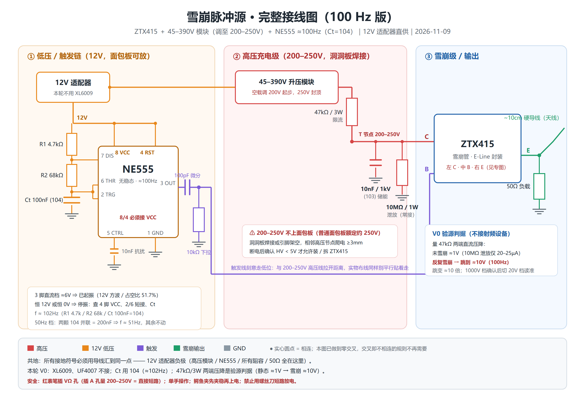
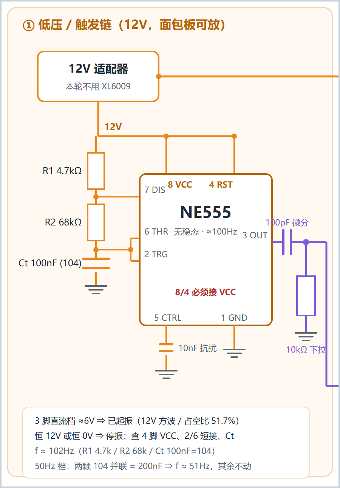
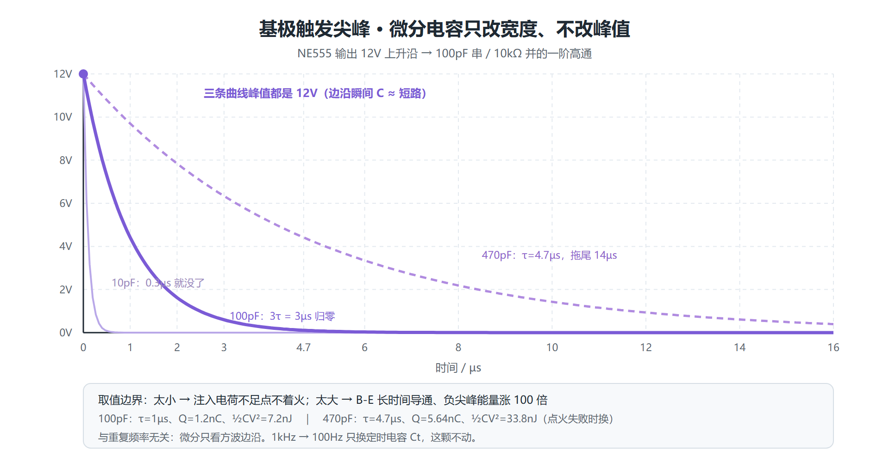
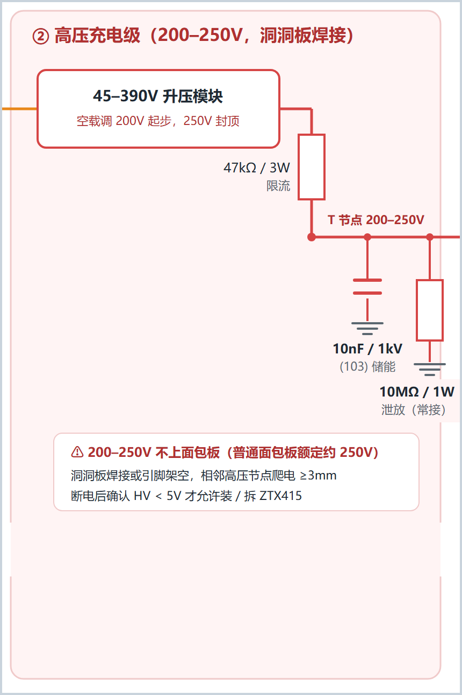
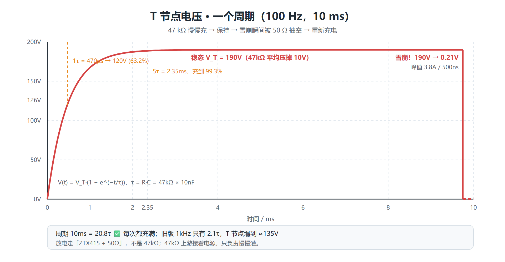
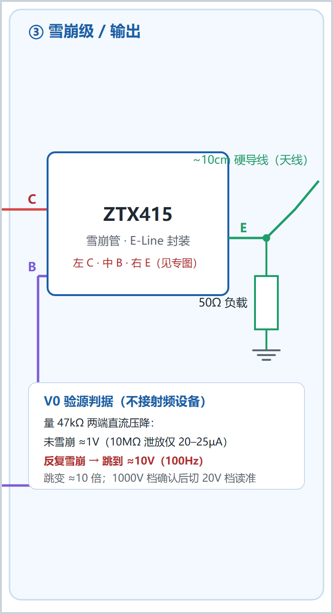

# 电路图图文讲解（按模块拆开看）

> 主图一张看全，但新手容易「盯着一整张图不知道从哪根线开始」。这篇把整机图**拆成三块**，每块一张局部图，逐根线讲：从哪来、到哪去、为什么这么接、参数怎么算、实物怎么焊、接错会怎样。
> 参数公式在 [`04-元件参数计算手册.md`](04-元件参数计算手册.md)，动手判据在 [`01-上电验收卡.md`](01-上电验收卡.md)。

---

## 0. 先看总图，建立全局印象



[网页版可无损缩放](figures/雪崩源_完整接线图_预览.html) · [ZTX415 雪崩级特写](figures/ZTX415_雪崩级接线图_单张版.png) · [脚位专图](figures/ZTX415_引脚与接线专图.png)

### 读图四条规则

| 规则 | 说明 |
|---|---|
| **颜色** | 红 = 200 V 高压 · 橙 = 12 V 低压 · 紫 = 触发 · 绿 = 雪崩输出 · 灰 = GND |
| **实心圆点 = 相连** | 没圆点的交叉不相连。主图做了**零交叉**设计，实际不用担心这条 |
| **接地符号** | 图上散落的 ⏚ 不是各自独立，实物必须**星形汇到一点：12 V 适配器负极** |
| **三个虚线框** | ①②③ 是**物理分区**，不只是画着好看：① 可插面包板，②③ 必须洞洞板焊接 |

### 整条链路一句话

```
12V ─┬─→ NE555(100Hz 方波) ──100pF 微分──→ ZTX415 的 B   ←「什么时候发」
     └─→ 升压模块(200V) ─47kΩ─→ T 节点 ─→ ZTX415 的 C   ←「能量从哪来」
                                  │
                              10nF 储能 + 10MΩ 泄放
                                  │
                    ZTX415 的 E ─50Ω─→ GND ＋ 10cm 天线   ←「往哪发」
```

**三区之间有 4 根跨区线**，局部图里它们会被切断，先记住去向：

| # | 颜色 | 从 | 到 | 传什么 |
|---|---|---|---|---|
| ① | 橙 | ① 区 12 V 适配器 | ② 区升压模块 VIN | 12 V 供电 |
| ② | 红 | ② 区 T 节点 | ③ 区 ZTX415 **C** | 190 V 高压 |
| ③ | 紫 | ① 区 NE555 3 脚（经 100 pF） | ③ 区 ZTX415 **B** | 12 V、1 µs 点火尖峰 |
| ④ | 灰 | 全部 ⏚ | 适配器负极 | 公共地 |

> 局部图是从总图**按坐标裁剪**出来的，接线与主图 100% 一致（生成脚本 [`tools/make_figures.py`](../tools/make_figures.py) 不改任何连线）。所以图边缘出现的「断头线」不是画错，是这根线去了另一个分区——**照上表接过去即可**。

---

## 1. 模块 ① · 低压 / 触发链（12 V，可插面包板）



### 1.1 这块在干什么

把 12 V 直流变成**每 9.75 ms 一个的 12 V 方波**，再把方波的上升沿削成 **1 µs 的窄尖峰**送给雪崩管基极。它只负责「什么时候发」，不提供任何发射能量。

### 1.2 逐根线讲

| 图上元素 | 从 → 到 | 为什么 |
|---|---|---|
| 12 V 适配器框 | 出两路：一路去 ② 区升压模块，一路留在本区 | 本轮直供，XL6009 不接 |
| 橙色 12 V 母线 | 接 R1 上端、NE555 的 **8 VCC / 4 RST** | 4 脚悬空必停振，是新手第一大坑 |
| R1 4.7 kΩ → R2 68 kΩ → Ct 104 | 串联到 GND，构成定时链 | 三个值一起决定 100 Hz |
| **7 DIS** | 接 R1/R2 中点 | 放电管在 Ct 放到 1/3 VCC 时导通 |
| **2 TRG + 6 THR 短接** | 接 R2/Ct 中点 | 两脚必须短接，漏了就停振；这个中点是最容易插错的 |
| **5 CTRL** | 10 nF 到 GND（可省） | 内部 3×5 kΩ 分压点，加了抗高频干扰 |
| **1 GND** | 公共地 | |
| **3 OUT** | → 100 pF → B 节点 | 方波出口 |
| 100 pF 串 + 10 kΩ 下拉 | 一阶高通微分器 | 把 12 V 方波削成 1 µs 尖峰 |
| 紫色低位走线 | 绕到图底再向右出图 | **刻意绕开高压区**，实物也别和 200 V 线平行贴着走 |

### 1.3 关键参数（详见 [04 手册第 3、4 节](04-元件参数计算手册.md)）

$$f = \frac{1.44}{(R_1 + 2R_2)C_t} = \frac{1.44}{(4.7\text{k} + 2\times68\text{k})\times100\text{nF}} \approx 102.5\ \text{Hz}$$

| 量 | 值 | 图上怎么验 |
|---|---|---|
| 占空比 | 51.7% | — |
| **3 脚直流档** | **≈6.20 V** | **Step 1 判据**：读到 6 V 就是起振了 |
| 触发尖峰 τ | 10 kΩ × 100 pF = **1 µs** | 万用表量不到（占空比 0.03%），别误判没信号 |
| 注入电荷 | 100 pF × 12 V = **1.2 nC** | 点不着火时换 470 pF，电荷涨到 5.64 nC |



**看图要点**：三条曲线**峰值都是 12 V**，只有尾巴长度不同——这就是为什么「下拉电阻会不会把尖峰拉低」是个伪问题。电容只改宽度，不改峰值。100 pF 是经验起点，470 pF 是点火失败时的加强档，10 pF 太窄点不着火。

### 1.4 实物与错接

| 项 | 做法 |
|---|---|
| 放哪 | 面包板即可，全是 12 V 侧 |
| Ct 丝印 | **必须是 104（100 nF）**；拿成 103 会跑回 ≈1 kHz，充电来不及 |
| R1/R2 别颠倒 | 4.7 k 在上、68 k 在下；颠倒占空比会极端化 |
| 4 脚忘接 VCC | 3 脚恒 0 V，停振 |
| 2/6 忘短接 | 3 脚恒 12 V 或恒 0 V，停振 |
| 10 kΩ 画成串联 | 必须从**基极节点下拉到 GND**，串在 100 pF 与基极之间会让基极悬空、随机自触发 |

**图边缘两根断头线**：右上橙线 → ② 区升压模块 VIN；右侧紫线 → ③ 区 ZTX415 的 **B**。

---

## 2. 模块 ② · 高压充电级（200–250 V，洞洞板焊接）



### 2.1 这块在干什么

把 200 V 高压**掐成 4.3 mA 的细流**，慢慢给 10 nF 充满，等 ③ 区一声令下把电放掉。它是「弹药库 + 限速器」，本身不产生脉冲。

### 2.2 逐根线讲

| 图上元素 | 从 → 到 | 为什么 |
|---|---|---|
| 45–390 V 升压模块 | 12 V 输入 → 200 V 输出 | 空载先调到 200 V，**250 V 封顶** |
| **47 kΩ / 3 W** | 模块 HV+ → T 节点 | 限流充电 + **淬灭**（后详）|
| **T 节点** | 三条支路汇合点，也是验源测量点 | 稳态 ≈190 V |
| 10 nF / 1 kV **(103)** | T 节点 → GND | 储能：雪崩瞬间要 3.8 A，47 kΩ 只给得出 4.3 mA |
| 10 MΩ / 1 W | T 节点 → GND，**全程常接** | 断电后 0.5 s 放净残压，安全件 |
| 右侧红线 | T 节点 → ③ 区 C | 把 190 V 送到雪崩管集电极 |

### 2.3 三条通路，别再混

这是整台设备最容易记串的地方：

| 阶段 | 电流走哪 | 量级 | T 节点 |
|---|---|---|---|
| 充电 | 200 V → **47 kΩ** → 10 nF → GND | 4.3 mA 递减到 20 µA | 0 → 190 V |
| 脉冲放电 | 10 nF → **③ 区 ZTX415 → 50 Ω** → GND | 峰值 3.8 A | 190 V → **0.21 V** |
| 雪崩末期 | 200 V → 47 kΩ → ZTX415 → 50 Ω → GND | 仅 4.3 mA | < 维持电流 → 关断 |
| 断电残压 | 10 nF → **10 MΩ** → GND | 20 µA，τ=0.1 s | 190 V → < 5 V |

**47 kΩ 上游接着电源，它不泄放、也不放电**。它的作用是把「硬电压源」变成「软电流源」：雪崩导通时 $V_T = 200 \times 50/(47\,000+50) \approx 0.21\ \text{V}$，电源还挂着，但补给只有 4.3 mA，远低于维持电流 $I_H$（几十 mA），管子于是自动关断。术语叫**限流淬灭**。



**看图要点**：指数充电 2.35 ms 到 99.3%（5τ），然后稳在 190 V 等到 9.75 ms，雪崩瞬间垂直掉到 0.21 V。周期 10 ms = **20.8τ**，所以每次都充满；旧版 1 kHz 只有 2.1τ，T 节点塌到 ≈135 V——这是把频率降下来的真正原因。

### 2.4 参数与选型（详见 [04 手册第 2、6 节](04-元件参数计算手册.md)）

| 量 | 公式 | 值 |
|---|---|---|
| 充电 τ | 47 kΩ × 10 nF | 470 µs |
| 充满 5τ | 5 × 470 µs | 2.35 ms |
| 单脉冲能量 | ½ × 10 nF × 190² | 0.18 mJ |
| 放电 τ | 50 Ω × 10 nF | 500 ns |
| **验源判据** | 47 kΩ 压降 | **静态 0.94 V → 雪崩 10.05 V** |

**储能位三个硬要求**：容值 10 nF（丝印 103）、耐压 ≥630 V 推荐 1 kV、材质 C0G/NP0 首选。X7R 在 200 V 直流偏压下容量会掉 20~40%，Y5V/Z5U 掉 80%；普通 50 V 瓷片焊上去会直接击穿。**绝不能把定时位的 104 换过来**——τ 变 4.7 ms，100 Hz 只有 2.1τ，脉冲反而更弱。

**47 kΩ / 3W 里的「3 W」是耐压需求，不是功率需求**：正常工作只有 2 mW，最坏（T 节点短路）0.85 W；但 1/4 W 色环电阻额定工作电压只有 200~250 V，搭在 190 V 上长期会漂移爬电。手上全是 1/4 W 时，用 **4×12 kΩ 串联**、**2×5.1 MΩ 串联**，零采购解决。

### 2.5 实物与安全

| 项 | 做法 |
|---|---|
| 放哪 | **洞洞板焊接或引脚架空**，普通面包板额定约 250 V、爬电不够 |
| 间距 | 相邻高压节点 ≥3 mm，高低压区物理隔开 ≥10 mm |
| 所有裸露点 | 套热缩管 |
| 断电后 | 万用表确认 HV < 5 V 才允许装 / 拆 ZTX415；模块内部 µF 级电容要等 ≥60 s |
| 表笔 | 黑 → COM、红 → **VΩ**；红表笔插 A 孔量 200 V 等于直接短路 |
| 禁止 | 用螺丝刀 / 镊子短路放电 |

**图边缘两根断头线**：左侧橙线 ← ① 区 12 V；右侧红线 → ③ 区 ZTX415 的 **C**。

---

## 3. 模块 ③ · 雪崩级 / 输出



### 3.1 这块在干什么

ZTX415 平时截止；基极收到 ① 区的 1 µs 尖峰后**雪崩导通**，把 ② 区存好的 10 nF 在几十 ns 内经 50 Ω 放空，形成亚 ns 前沿的宽带脉冲，由 10 cm 导线辐射出去。

### 3.2 三个引脚各接什么

| 脚 | 线色 | 来自 | 说明 |
|---|---|---|---|
| **C**（左，1 脚） | 红 | ② 区 T 节点 | 190 V 高压输入端 |
| **B**（中，2 脚） | 紫 | ① 区 100 pF 微分 + 10 kΩ 下拉 | 点火端，只认边沿 |
| **E**（右，3 脚） | 绿 | 50 Ω → GND，同一点分出 10 cm 天线 | 放电回路 + 辐射 |

> ⚠️ **ZTX415 是 E-Line 封装，印字面朝自己、引脚朝下：左 C · 中 B · 右 E**。常见 TO-92 多是 E-B-C，正好相反。依据：立创 C5245685 引脚图 `C1B2E3`、Diodes datasheet 封装图 `C B E`。散装货一律实测：万用表二极管档，红表笔固定一脚、黑表笔碰另两脚，**两次都读 0.60–0.70 V 的就是 B**，且应在中间。C/B/E 焊反是「点不着火」的头号原因。

### 3.3 关断是「与」条件

| 端口 | 谁负责 | 条件 |
|---|---|---|
| 基极侧 | **10 kΩ 下拉**（① 区） | 撤掉点火尖峰，τ=1 µs 把节点放回 0 V |
| 集电极侧 | **47 kΩ 限流**（② 区） | 10 nF 放空后补给只剩 4.3 mA < $I_H$，防自持 |

只撤基极而让高压直连 T 节点 → 持续电弧烧管；只有限流而基极悬空 → 随机自触发。**10 MΩ 不参与脉冲关断**（τ=0.1 s，比 ns 级慢 6 个数量级），它只在断电后工作。

### 3.4 输出与验源

50 Ω 是惯用阻抗，把峰值电流定在 ≈3.8 A；10 cm 硬导线是临时天线，够 V0 用。

图右下的白框是**零射频验源判据**——不买任何接收设备，只量 ② 区 47 kΩ 两端直流压降：

| 读数 | 结论 |
|---|---|
| ≈1 V，NE555 开关都一样 | 没点着火：脚位 / 触发 / 电压 |
| **从 ≈1 V 跳到 ≈10 V** | **雪崩在反复放电 ✅ 本级通过** |
| NE555 关着就很大 | 自激，电压过高 |

两表笔共模都在 ≈190 V、彼此差压只有 1~10 V，所以**先用 DCV 1000 V 档确认差压 < 20 V，再切 DCV 20 V 档读准**。完整推导见 [04 手册第 8 节](04-元件参数计算手册.md)。

**图边缘两根断头线**：左侧红线 ← ② 区 T 节点（C）；左侧紫线 ← ① 区 100 pF 微分输出（B），它在低位绕行后从这里竖上来。

---

## 4. 按图施工：四步各点亮哪一块

| Step | 图上涉及 | 通电范围 | 过关判据 |
|---|---|---|---|
| **1** | **只有 ① 区**（NE555 + R1/R2/Ct） | 12 V，**② 区升压模块不接 12 V** | 适配器 12.0 V、4 脚 12.0 V、3 脚直流 **≈6 V** |
| 2 | ② 区升压模块（输出悬空） | 只模块 | 空载调到 **200 V**，记下电位器位置 |
| 3 | ② 区 47 kΩ + 10 nF + 10 MΩ（**仍不装管子**） | ② 区 | 10 nF 上端 ≈200 V；断电后电压缓慢归零（证明泄放接上了） |
| 4 | 全图（装 ZTX415） | 全部 | 47 kΩ 压降从 1 V 跳到 ≈10 V |

> **③ 区在 Step 1–3 全程保持空着**，先不要插 ZTX415。这样前三次上电时，即使接错也不会烧管。

---

## 5. 看图最容易误读的 6 处

| 误读 | 实际 |
|---|---|
| 「交叉的线应该相连吧」 | 主图零交叉；**有实心圆点才相连** |
| 「⏚ 符号各自接地就行」 | 必须星形汇到**适配器负极一个点**，别拿面包板长条地轨当高压脉冲回路 |
| 「C/B/E 按 TO-92 习惯插」 | ZTX415 是 **C-B-E**，与常见 E-B-C 相反 |
| 「47 kΩ 是放电电阻」 | 它上游接着电源，只限流；放电走 ZTX415+50 Ω，泄放走 10 MΩ |
| 「10 nF 和 10 MΩ 是一对，都在放电」 | 10 nF 存能量，10 MΩ 只在**断电后**放净残压 |
| 「局部图边缘的断头线是画漏了」 | 是跨区线，按第 0 节那张 4 行表接过去 |

---

## 6. 图文件与重新生成

| 文件 | 用途 |
|---|---|
| `雪崩源_完整接线图_100Hz.png` / `.svg` / `_预览.html` | **整机主图**，照着焊 |
| `模块1_低压触发链.png` / `.svg` | 本文第 1 节配图 |
| `模块2_高压充电级.png` / `.svg` | 本文第 2 节配图 |
| `模块3_雪崩输出级.png` / `.svg` | 本文第 3 节配图 |
| `参数曲线_充电与放电.png` / `.svg` | T 节点波形，讲 τ 与淬灭 |
| `参数曲线_微分尖峰.png` / `.svg` | 三档微分电容对比 |
| `ZTX415_雪崩级接线图_单张版.png` | 雪崩级特写 |
| `ZTX415_引脚与接线专图.png` | 脚位 + 万用表验脚 + 参数表 |

改了总图或参数后，一键重生成全部局部图和曲线：

```bash
cd D:/workbuddy/docs/pd
python tools/make_figures.py --png     # 生成 3 张分区图 + 2 张曲线，并渲染 PNG
python tools/calc_params.py --compare # 核对曲线用到的数值
```

`make_figures.py` 的裁剪只改 `viewBox`，**不改总图任何一根线**；曲线图按 `calc_params.py` 的同一套公式画，所以图和文字不会各说各话。

---

> **今天只做 Step 1**：高压模块别接 12 V，只插 ① 区 NE555，量适配器 12.0 V、4 脚 12.0 V、3 脚直流档 ≈6 V，三个数报回来再往下走。
